# Workforce Planning Analytics: From Workforce Data to Executive Decisions

*A portfolio case study for an enterprise workforce planning data analyst role (Australia / Western Australia).*

> **Read this first.**
> - **Kestrel Health Services (KHS) is fictional**, and all of its internal data is **synthetic**.
> - All labour-market evidence is **real public data**, downloaded on 22 Oct 2026 and listed with direct links in [source_register.md](source_register.md).
> - Every number in this report is produced by code in `src/` and stored in `outputs/`.
> - Tags: **[R]** = real, **[S]** = synthetic, **[M]** = model output.

---

## 1. The question

> How should KHS, a 2,000-employee WA health provider with six sites, manage workforce shortages, vacancies, recruitment capacity and labour costs over FY2027–FY2029?

Full business case: [business_case.md](business_case.md) (stakeholders, constraints, success measures, decisions).

## 2. Research first: what public data exists (Phase 1)

I searched for and verified 21 public files from the ABS Data API, Jobs and Skills Australia and the WA Public Sector Commission before designing the analysis. They cover:
- **supply**: Labour Force, EQ08 occupation by state, Census age profiles;
- **demand**: JSA employment projections, Internet Vacancy Index, population;
- **shortage and recruitment conditions**: Occupation Shortage List, REOS, Job Vacancies, Labour Account;
- **turnover benchmarks**: ABS Job Mobility;
- **labour cost**: WPI, AWE.

**What public data cannot provide:** employer-level vacancies, time-to-fill, turnover, or anything about individual employees. Those fields are synthetic here, and they are labelled as synthetic everywhere. Three hoped-for sources turned out not to exist as files: state-level shortage ratings, a downloadable National Health Workforce Dataset, and WA × industry job mobility. They were excluded rather than approximated. [source_register.md §C](source_register.md)

**Why health in WA** [R]:
- Registered Nurses, Midwives, medical practitioners and key allied health occupations are rated in national shortage (JSA OSL 2026).
- WA RN online ads are 93% above their 2019 level.
- WA has 0.56 job vacancies per unemployed person, against 0.24 in 2015–19.

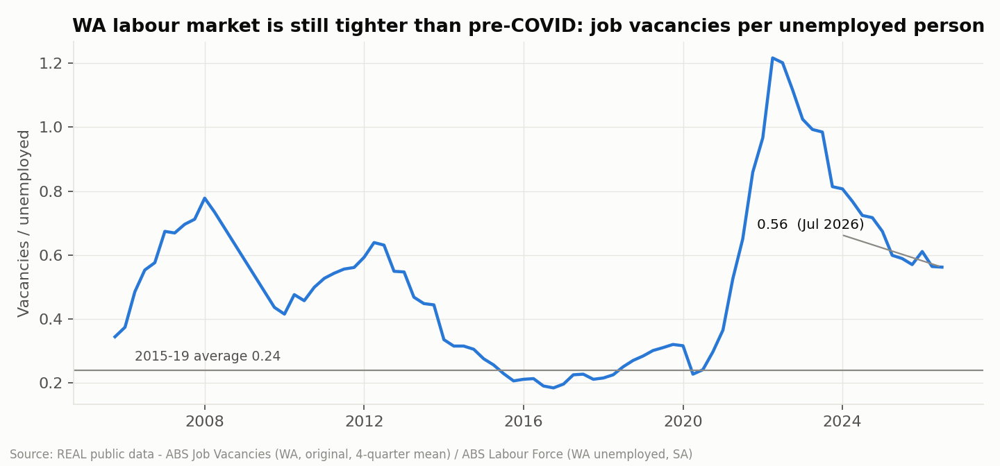
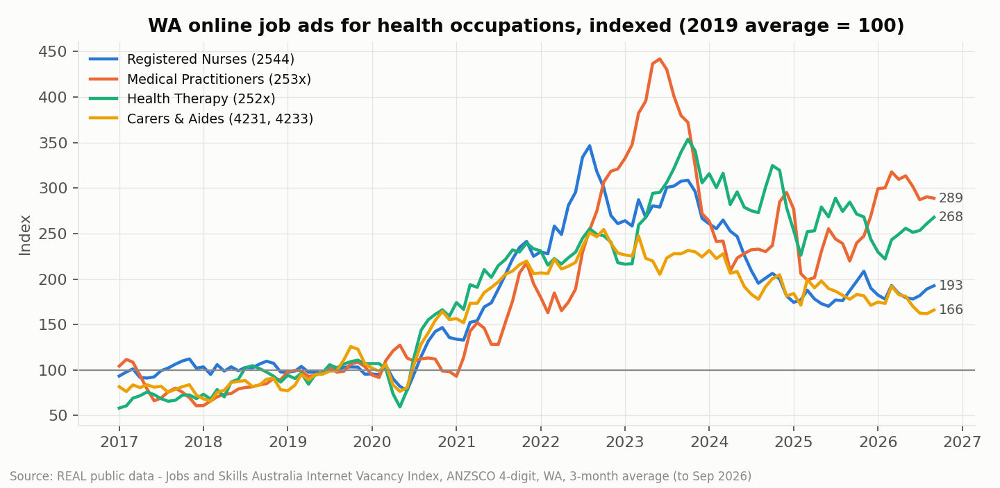

## 3. Data engineering and quality (Phase 3)

The pipeline (`run_all.sh`, about 3 minutes):
1. Download with an SHA-256 manifest.
2. Standardise ABS SDMX into a single tidy table.
3. Parse each publisher's spreadsheet by locating headers by content.
4. Generate synthetic source systems with injected defects.
5. Clean and reconcile.
6. Analyse.
7. Backtest.
8. Model.
9. Build and verify Excel.
10. Re-implement the key transforms in SQL and cross-check.
11. Chart.

**Real-data issues found and handled** [R]:
- The ABS Job Vacancies survey was suspended from 2008-Q3 to 2009-Q3 (510 null cells).
- WA seasonally adjusted part-time employment is not published, so it is derived.
- The ABS population age dimension mixes levels and triple-counts if summed.
- Census sub-areas do not add to the state total (perturbation plus migratory/offshore categories).
- The IVI has 3,458 suppressed cells.

Each is caught by a named rule (R1–R7) with an exception log.

**Internal data** [S]: the raw HRIS extract had 2,057 "active" rows for 1,990 real employees. Duplicates, stale rehire records, leavers still marked Active, decimal-shifted FTE and inconsistent labels inflated FTE by 6.2%. Raw figures make KHS look over its establishment when it is actually 74.3 FTE (4.4%) vacant. After cleaning:
- headcount, job family, location and hire date match the hidden truth exactly;
- FTE is 1,627.5 against a true 1,627.6;
- every payroll mismatch is explained (final pays, contractors, leave without pay);
- SQL and Python agree exactly.

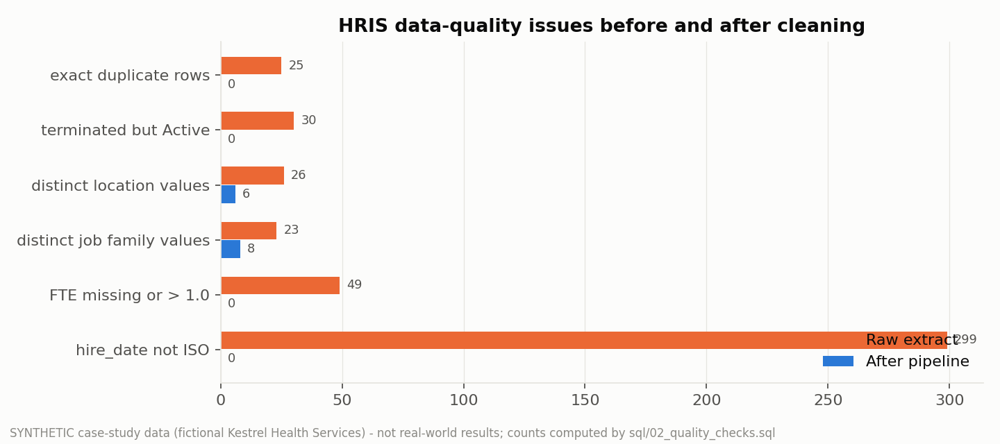

Details: [data_quality_report.md](data_quality_report.md) · [data_dictionary.md](data_dictionary.md) · SQL in [`sql/`](../sql).

## 4. Workforce analysis (Phase 4)

Definitions, formulas and denominators: [metric_definitions.md](metric_definitions.md).

| Metric | Value | Benchmark |
|---|---|---|
| Headcount / FTE (30 Jun 2026) | 1,990 / 1,627.5; 0.82 FTE per head [S] | WA public-sector RNs: 0.71 FTE per head [R] |
| Vacancy rate | 4.4% (Broome 14.0%) [S] | – |
| Turnover FY2026 | 14.5%, down from 17.7% in FY2023 [S] | ABS HCSA job-mobility outflow 10.8% [R] (a different concept) |
| Early attrition | 24.2%; Care Workers 38.8% [S] | – |
| Median time-to-fill | 39 days; Medical 101 days [S] | OSL vacancy duration: 10.6 weeks (shortage) vs 7.8 (no shortage) [R] |
| Age 55+ | 21.5% [S] | WA HCSA 22.9%; Rest of WA 27.7% (Census 2021) [R] |
| Agency spend | $3.6M (FY2023) → $6.6M (FY2026) [S] | – |

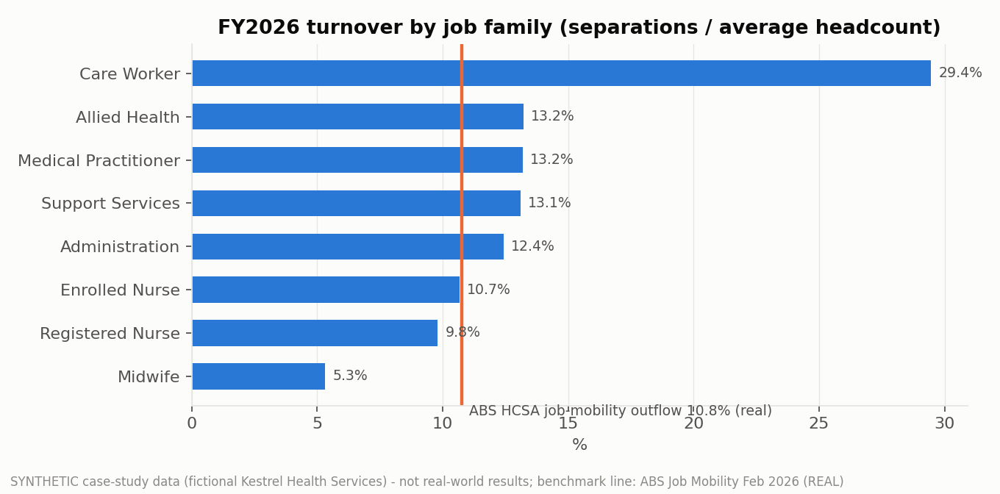
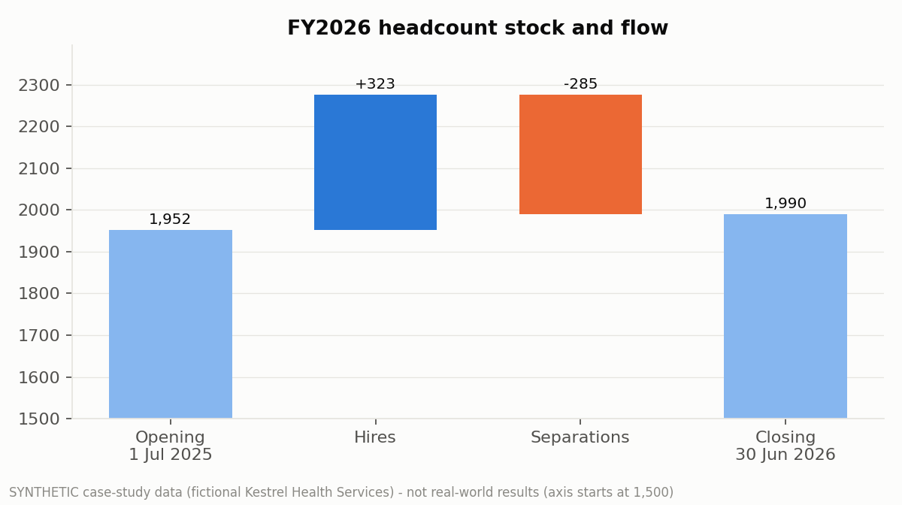

The risk score combines internal metrics [S] with real occupation indicators [R]: the OSL rating and WA ads per 100 employed. Medical Practitioners and Allied Health rank highest; Broome and Kalgoorlie are the highest-risk sites.

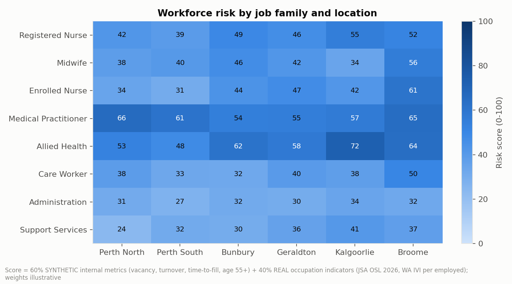

## 5. Forecasting and scenarios (Phase 5)

**Method selection by backtest** [R]: across five methods, a 12-quarter rolling-origin backtest gives a best error of 3.5% for national health employment, 4.7% for WA employment and 10.1% for WA RN employment. State × occupation series are too noisy to trend, so demand growth comes from JSA occupation projections. All methods under-forecast health growth.

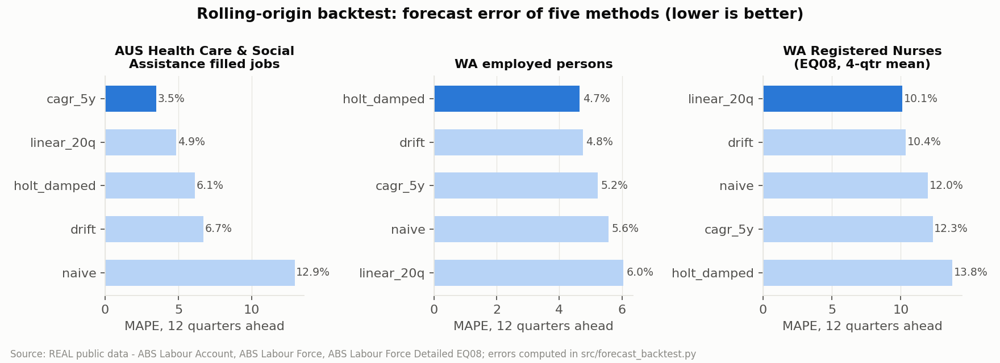

**Stock-and-flow model** [M]: Ending = Starting + Hires + Graduates + EN→RN in + Net transfers − Separations − EN→RN out. It runs for 48 cells over 3 years and 3 scenarios, with every assumption tagged by evidence ([forecasting_and_scenarios.md](forecasting_and_scenarios.md)).

| FY2029 | Baseline | Growth | Constraint |
|---|---|---|---|
| Shortage FTE | 27.9 | 57.9 | **182.4** |
| Hires required vs capacity | 376 / 478 | 449 / 478 | **566 / 394** |
| 3-year agency cost | $13.2M | $20.9M | **$48.5M** |
| 3-year unfilled FTE-years | 61 | 97 | 252 |

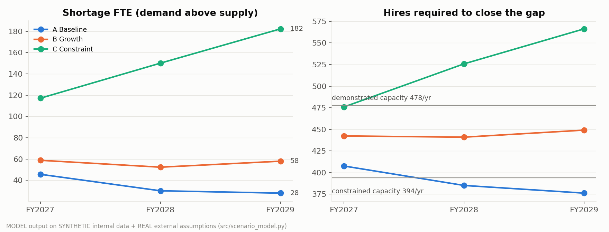
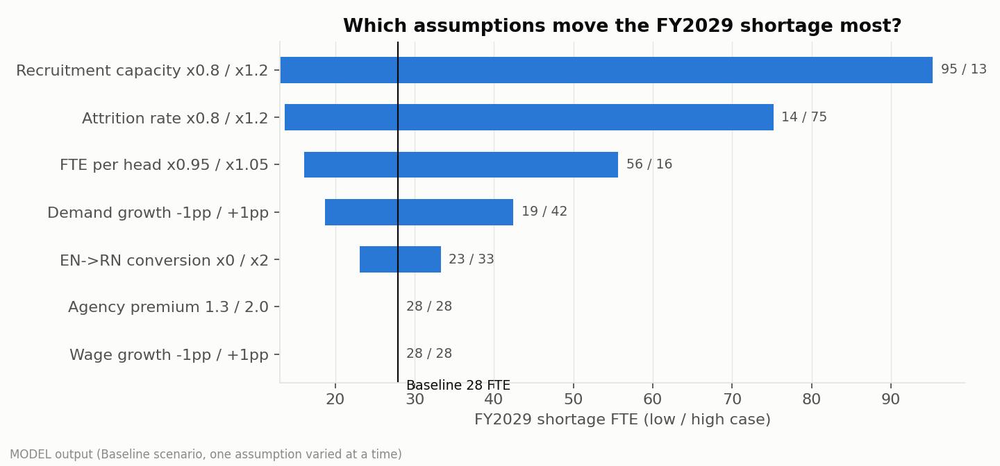
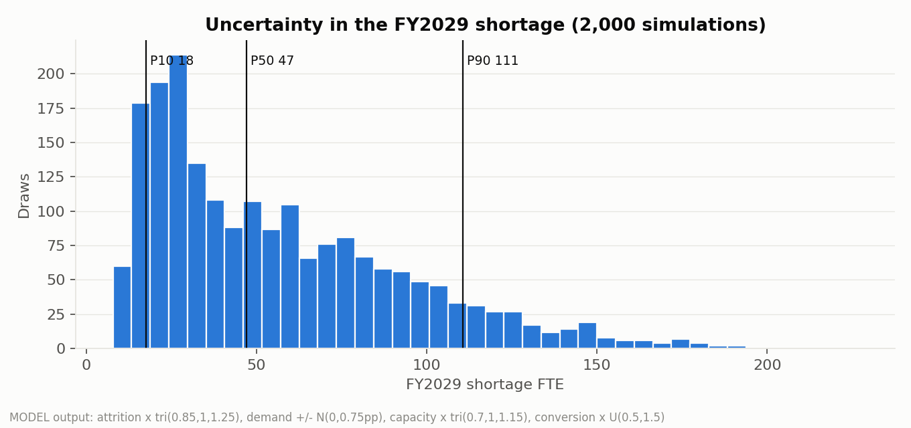
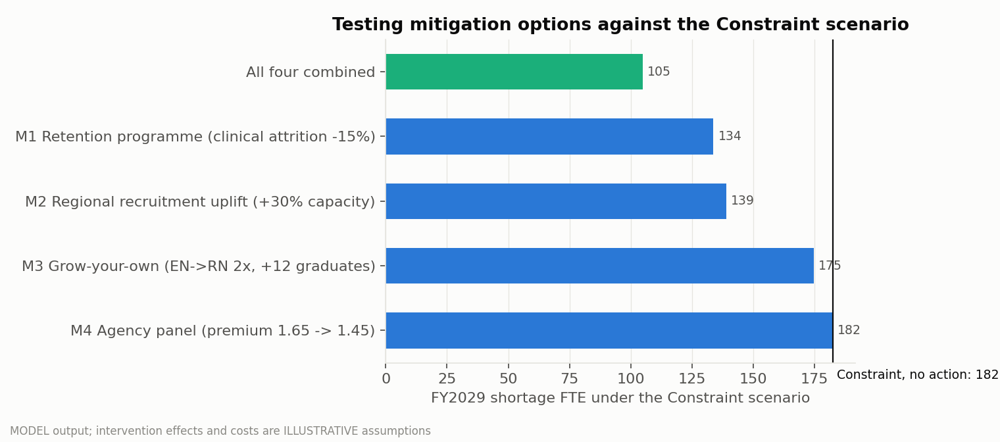

## 6. Executive insights (Phase 6)

The full findings and recommendations are in [executive_summary.md](executive_summary.md). In brief:
1. Fix the single source of truth first: raw data inverts the vacancy picture.
2. Medical and Allied Health: recruit earlier, use a locum panel, build pipelines.
3. Care Workers: first-year retention.
4. Regional sites: fund recruitment capacity; this was the strongest option in testing, on illustrative costs.
5. RNs: redeploy graduates to regional sites rather than recruit more in metro.
6. Capacity and attrition drive shortage; agency pricing only drives cost.
7. Hold a downside playbook with measurable triggers.

## 7. Dashboard (Phase 7)

A Power BI design is provided: 7 pages, a star schema, KPI definitions and sample DAX ([dashboard_spec.md](dashboard_spec.md)). **No .pbix has been built.**

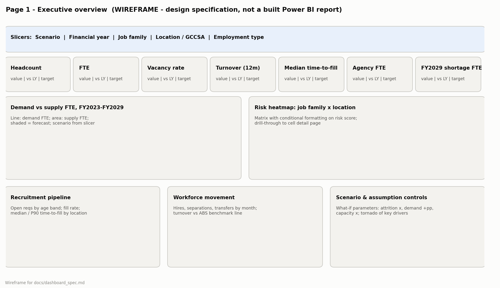

## 8. Limitations

The internal data is synthetic. The 100% cleaning-rule recall is expected, because I wrote both the defects and the rules. Shortage ratings are national only. Demand is proxied by establishment, and intervention effects are illustrative. What real data is needed, and how to get it: [limitations_and_next_steps.md](limitations_and_next_steps.md).
